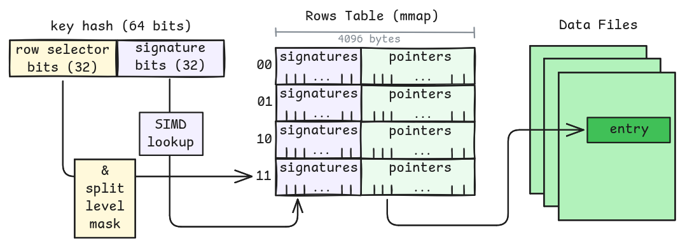
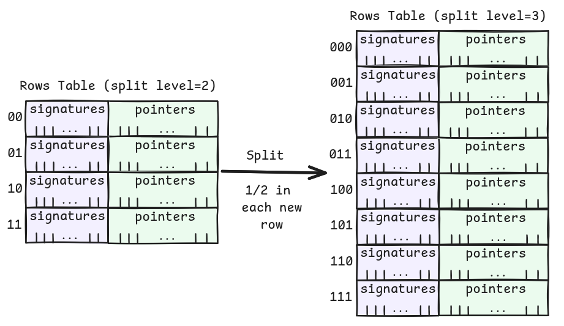

<div></div>

> [!NOTE]
> v1.2.2 fixes checkpoint durability, crash recovery, interrupted index shrinking, mmap aliasing,
> iterator healing, and list-item moves. It also corrects tombstone retention and makes compaction
> cancellation responsive. The on-disk format is unchanged.
>
> v1.2 adds corrupt-entry cleanup and failure-tolerant compaction, and fixes concurrency bugs;
> file format is unchanged.
>
> v1.1 fixes durability issues in checkpointing (data files are now `fdatasync`ed) and some (very
> rare) concurrency issues; file format is unchanged.
>
> 😸 v1.0 brings true crash-consistency, improved compaction and an overall simpler design,
> as well as a stable file format.

# CandyStore

A pure Rust implementation of a fast (*blazingly* :tm:, of course), persistent, in-process
key-value store that relies on a hash-based sharding algorithm. All operations — lookup,
insert, and removal — are O(1).

| Operation | Time*  |
|-----------|--------|
| Lookup    | < 1us  |
| Insert    | < 1us  |
| Update    | < 2us  |
| Removal   | < 2us  |

On my laptop (32 core AMD RYZEN AI MAX+ 395 with 64GB RAM, running Ubuntu 25.10 kernel `6.17.0-19-generic`) I'm getting

```bash
$ cargo run --release --example perf

Testing key-value using 1 threads, each with 1000000 items (key size: 16, value size: 16)
    Inserts: 0.530478 us/op
    Updates: 0.626602 us/op
    Positive Lookups: 0.311369 us/op
    Negative Lookups: 0.045717 us/op
    Iter all: 0.366935 us/op
    Removes: 0.604568 us/op
```

See [how to interpret the results\*](#how-to-interpret-the-performance-results).

## APIs

Candy offers
* A simple key-value API (`get`, `set`, `remove` and atomic operations like `replace`)
* A typed interface on top (`CandyTypedStore<K, V>` with `get`, `set`, etc.)
* Double-ended queues (`push_to_queue_tail`, `pop_queue_head`, etc.) as well as a typed interface on top of them
* Lists (`get_from_list`, `set_in_list`, etc.) as well as a typed interface on top of them
* The DB is completely thread-safe in idiomatic Rust (just `Arc<>` it)

```rust
use candystore::{CandyStore, Config, Result};

fn main() -> Result<()> {
    let db = CandyStore::open("/path/to/db", Config::default())?;

    db.set("hello", "world")?;
    let val = db.get("hello")?;
    assert_eq!(val, Some(b"world".to_vec()));
    db.remove("hello")?;

    db.set_in_list("cities", "Barcelona", "Spain")?;
    db.set_in_list("cities", "Chicago", "USA")?;
    db.set_in_list("cities", "Caracas", "Venezuela")?;

    let cities: Vec<String> = db.iter_list("cities")
        .map(|res| String::from_utf8(res.unwrap().0).unwrap())
        .collect();

    assert_eq!(cities, vec!["Barcelona", "Chicago", "Caracas"]);

    Ok(())
}
```

## Algorithm

The algorithm can be thought of as a "zero-overhead extension" to a hash table stored over
files, designed to minimize IO operations. It does not employ a WAL or a journal, and instead 
uses append-only files that serve both as a source of truth and as the final data structure. 
Unlike LSM-based stores that need to maintain large SSTables in memory, sort them and later 
merge them, Candy uses a small mmap'ed index that points to on-disk data directly.



The core of the algorithm is the concept of *hash coordinates*: breaking up a 64-bit hash 
into two 32-bit values, a *row selector* and a *signature*, which can be thought of 
as coordinates into the rows table. First, the row selector is used to locate the relevant
row in the table, and the signature locates the column. To find the row, we take the row
selector's bits and mask them with a *split level mask*, essentially, the number of rows 
in the table. 

To locate the signature (32 bits) within the row, we employ a parallel lookup (using SIMD) 
to find the matching column(s). Then we fetch the corresponding pointers for the matched 
columns, from which we extract another 18 bits of entropy. If both match, we fetch the entry
from the relevant file (the pointer stores a file index and a file offset). 

Note: the chances of a collision (meaning we fetch a wrong entry from the file) are 
virtually zero, about 1 in 20 billion according to the birthday paradox (a collision in 336 
uniformly-distributed 50-bits numbers). 

Candy supports up to 4096 files, each slightly less than 1 GiB in size (a span of roughly
4 TiB). In terms of key-space, Candy allows 2^21 rows, each with 336 keys, so a total of
704M keys. The maximum user key size is `MAX_USER_KEY_SIZE` (16,367 bytes), and the maximum
inline value size is `MAX_USER_VALUE_SIZE` (65,471 bytes). The configured data-file size
and collection overhead can impose smaller limits. These are theoretical limits; it would
be wise to leave headroom in practice due to imbalances.

### Splitting

What happens when a row reaches its limit of 336 keys? We need to split it, of course.
To do that, we increase the row's split level by one, which means we take an extra bit 
into account when selecting the row. For example, row 2 (0b010) will be split into 
rows 2 (0b0010) and 10 (0b1010). Because the bits are uniformly distributed, we expect about
half of the entries to move from row 2 to row 10.



Note that splitting may require increasing the global split level (the size of the table)
which will incur doubling the mmap's size. This may sound like a costly operation, but since
it's file-backed it's mostly only page-table work, and it's amortized. And since we only 
split a single row -- we do not need to rehash the whole table -- the amount of work we 
do is O(1). 

Another optimization is that the pointer contains 18 bits of the row selector, which means
we do not need to read and recompute the hash coordinates of the keys. Splitting is thus
memory-bound.

### Compaction

Data is always written (appended) to the *active data file*. When a file reaches a certain size,
Candy rotates the active files and creates a new one. The old file becomes an *immutable data 
file*. 

As data is created, updated and removed, the store accumulates waste. To handle it we have
*background compaction*: a thread that selects checkpointed immutable files whose reclaimable
waste exceeds `compaction_min_threshold`, finds their live entries in the rows table, and
rewrites them to the active file. After making the rewritten data and index rows durable,
it deletes the old immutable files, oldest first. When an older file remains, deletion
markers for absent keys are preserved so an index rebuild cannot resurrect older values.
Files containing only still-needed markers are deferred rather than repeatedly rewritten;
markers for reinserted keys become reclaimable. If a required scan fails, its source files
are retained rather than risking the loss of valid deletion markers.

Corrupt-entry cleanup searches checksum-verified history for keys matching the damaged index
slot, then writes and synchronizes deletion markers before retiring the pointer. This exceptional
path can scan older data files and wait for synchronization. `compaction_max_read_failures` controls when cleanup is attempted after read
failures; if the relevant history cannot be read safely, compaction reports an error and keeps
the source file instead of dropping an unidentified entry.

You can configure the throughput (bytes per second) with `compaction_throughput_bytes_per_sec`;
setting it to `0` disables background compaction. File scans and pacing waits can be cancelled
during shutdown.

### Checkpointing & Rebuild

Ordinary writes append to the operating system's page cache and update the mmap'ed index;
they do not synchronize every mutation to storage. A process crash can interrupt an operation,
and a power failure or kernel panic can persist index pages and data files out of order.

To handle this gracefully, Candy employs **background checkpointing**. Instead of synchronously `fsync`ing index and data files on every write (which would block the writer), a background worker asynchronously persists a consistent snapshot of the current state at user-defined intervals or after a configured amount of bytes have been written.

Checkpointing synchronizes data files before index rows and publishes the recovery cursor last.
Collection locks are held through the final synchronization pass, so a completed checkpoint
does not split a compound list or queue mutation. These operations are not multi-record
transactions, however: interruption before a checkpoint can leave an operation partially applied.

Removals become invisible immediately, but their old index pointers are retained in an
in-memory pending-deletion set until the tombstones are synchronized. Checkpointing,
compaction, and row-space reclamation then unlink those pointers safely. Keeping background
checkpointing enabled bounds this temporary memory use; applications that disable it should
call `checkpoint()` periodically.

On an unexpected crash or an unclean shutdown, Candy normally resumes from the latest successful
checkpoint and replays recent operations from the append-only data files. If a surviving index
pointer refers to a lost data tail, or replay encounters a damaged region, recovery restarts from
the earliest remaining file so older valid values can be restored consistently. Recovered data
and rebuilt rows are synchronized before publishing a new checkpoint.

Opening also traverses the live index and temporarily maps data files to read record headers
for entry counts and per-file waste. It does not issue a separate read or scan each live payload
for this accounting. Startup still scales with the live index and header pages, as well as any
operations that need replay.

The durability guarantee is therefore checkpoint-granular: a write is guaranteed to survive power loss
once a checkpoint (or an explicit `flush()`) completes after it. Writes made after the last checkpoint
are replayed if they reached the disk, and lost otherwise. Checkpoints run every `checkpoint_interval`
(default 5s) or every `checkpoint_delta_bytes` written (default 128KB), whichever comes first, and
can be forced with `checkpoint()` when you need a synchronous durability point.

Starting with v1.0, those append-only data files are also the on-disk compatibility contract. By default (`Config::port_to_current_format = true`), Candy uses that same rebuild path when it encounters an outdated index-file version alongside data files whose format is still recognized. In that case it recreates only the `index` and `rows` files and rebuilds them from the append-only data files.

This does not make arbitrary older releases compatible. The v1.0 compatibility promise applies to stores written with the stable v1.x data-file format; if the data-file format itself is not recognized, open still fails.

## Design Goals

Unlike many key-value stores, Candy serves the purpose of *reducing* the memory footprint of your
process, e.g., offloading data to the disk instead of keeping it in-memory. It intentionally does not 
include any caching/LRU layer like many traditional KVs/DBs.

Example use cases for Candy are
* A hash table that needs to hold more keys than you can hold in memory
* Persistent work queues (e.g., producers append large work items to a queue and consumers then fetch 
  and perform them) 
* A caching layer for your application logic

Durability is bounded by the last completed checkpoint. Recovery replays surviving writes beyond
that point, but interrupted compound operations may be partially applied
(see [Checkpointing & Rebuild](#checkpointing--rebuild)).

## How to Interpret the Performance Results

While the numbers shown above are incredible, it is obvious that any persistent store will be
limited by the underlying latency and bandwidth of the storage. For example, you can expect a 
read latency of 20-100us from SSDs (NVMe), so that's the lower bound on reading a random
location in the file.

What the numbers above measure is the performance of the *algorithm*, not the *storage layer*:
given the index can be kept mapped into memory (12 bytes per item), lookup and insert require
a single disk IO, while updating or removing requires two IOs. These IOs may be served 
from the kernel's page cache, in which case you only pay for the syscall's latency, or 
from disk, in which case you can expect it to take 1-2 round-trip times of your device.
